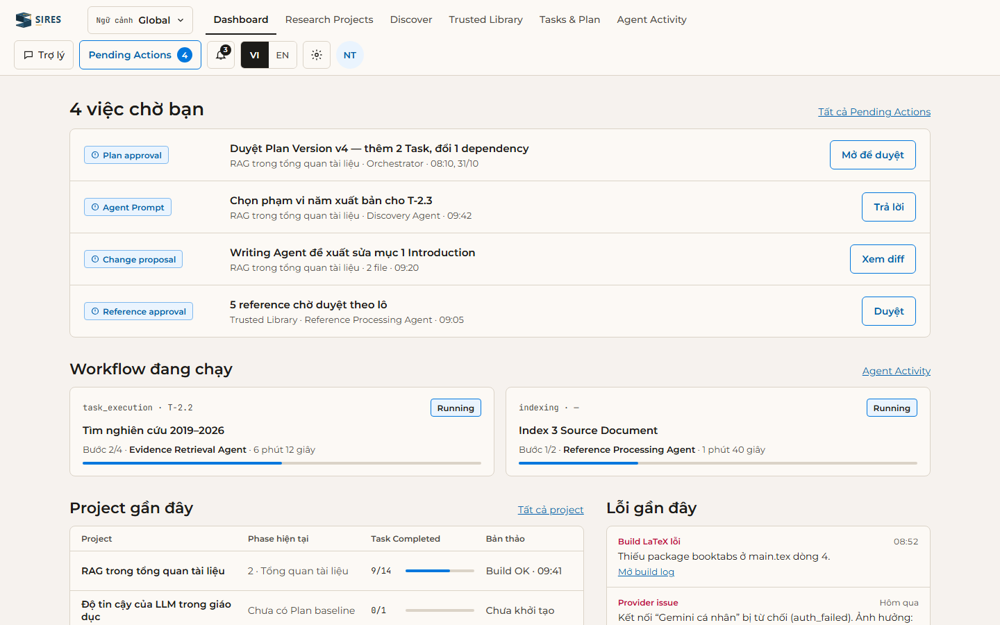
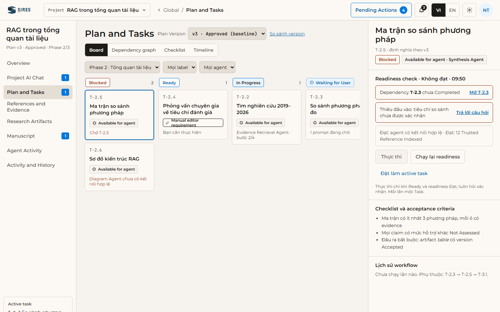
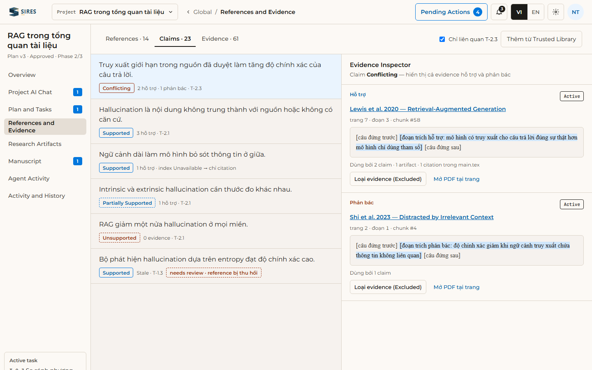
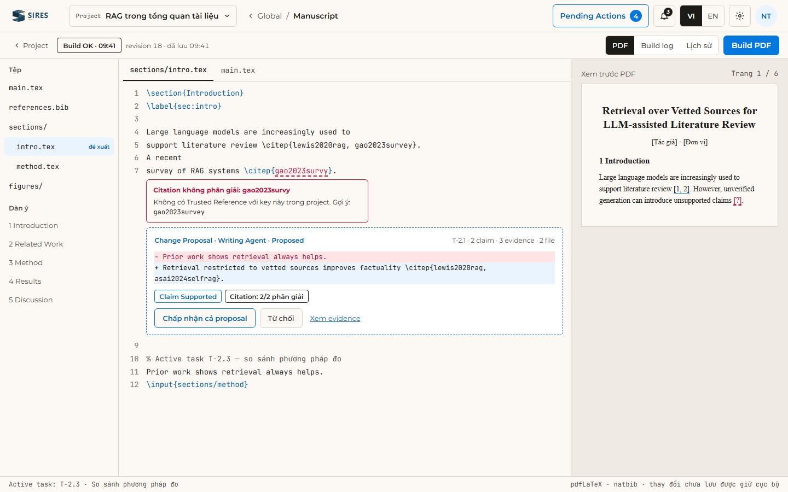
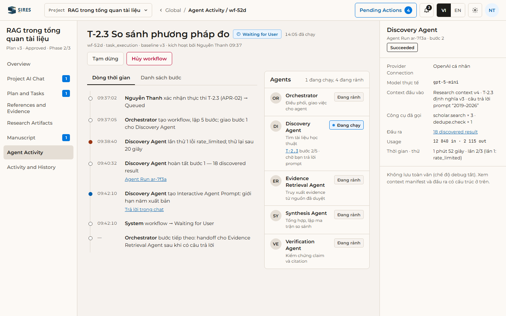
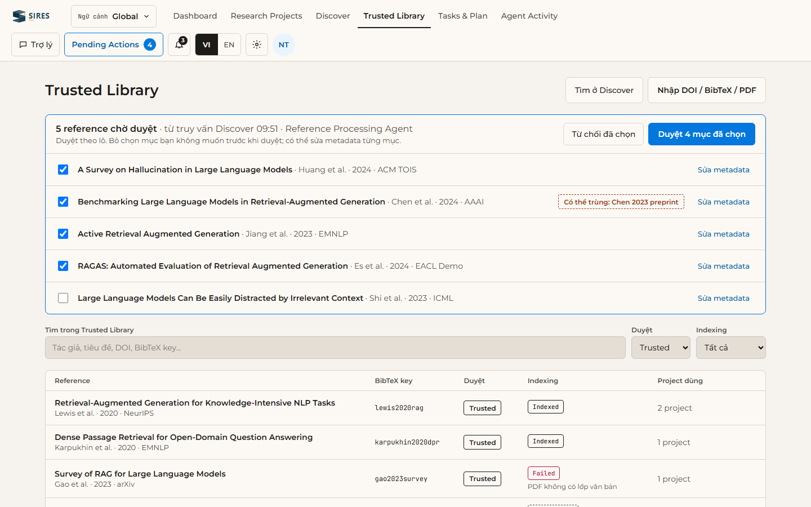

<p align="center">
  
</p>

<h1 align="center">SIRes — Super Intelligence Researcher</h1>

<p align="center">
  AI Research Assistant cho người làm nghiên cứu, thuộc nền tảng <strong>eTroy One</strong>.
  <br>
  <a href="docs/overview/index.html">PRD</a> ·
  <a href="docs/architecture/index.html">Kiến trúc</a> ·
  <a href="docs/api-design/index.html">API</a> ·
  <a href="docs/ui-design/index.html">Thiết kế giao diện</a> ·
  <a href="LICENSES.md">Giấy phép</a>
</p>

<p align="center">
  
  
  
</p>

---

## Giới thiệu

**SIRes** là AI Research Assistant giúp học viên cao học, nghiên cứu sinh và giảng viên đi hết một vòng nghiên cứu trong cùng một sản phẩm web: từ lập kế hoạch, tìm và duyệt tài liệu, tổng hợp evidence đến viết bản thảo LaTeX có citation truy vết được.

SIRes không phải chatbot trả lời một lần. Mỗi Research Project có **Plan** được duyệt và quản lý phiên bản, các **Task** do người dùng chọn để thực thi, và một nhóm **multi-agent** do Orchestrator điều phối. Agent dùng chung context nhưng mọi quyết định quan trọng đều chờ người dùng duyệt (human-in-the-loop).

> tạo Research Project → làm rõ ngữ cảnh với Orchestrator → nhận và phê duyệt Plan → chọn và thực thi từng Task → tìm và duyệt tài liệu → tổng hợp evidence → viết bản thảo LaTeX có citation truy vết được → quay lại sau gián đoạn mà không mất trạng thái.

### Điểm chính

- **Plan và Task dài hạn:** Plan phải được duyệt trước khi thực thi. Plan đã duyệt là baseline có phiên bản. Người dùng chọn từng Task, hệ thống không tự chạy Task tiếp theo.
- **Trusted Library:** tìm tài liệu qua Google Scholar (dự phòng OpenAlex, Semantic Scholar) hoặc nhập DOI, BibTeX, PDF. Reference được duyệt theo lô và dùng lại ở mọi project.
- **Evidence trước, câu chữ sau:** RAG trên Trusted Reference đã index giúp giảm hallucination. Mỗi claim gắn với evidence hỗ trợ hoặc phản bác, có trang, đoạn và chunk.
- **Manuscript LaTeX:** editor, build PDF, Change Proposal dạng diff do Writing Agent đề xuất, kiểm tra citation trước khi chấp nhận.
- **Multi-agent độc lập provider:** Orchestrator và các Specialist Agent (Discovery, Evidence Retrieval, Synthesis, Verification, Writing, Diagram…) chạy trên Claude, OpenAI hoặc Gemini bằng API key của người dùng.
- **Giám sát và khôi phục:** theo dõi workflow, từng Agent Run và Pending Actions. Workflow bị gián đoạn khôi phục được qua nhiều phiên.
- **Đăng nhập eTroy OIDC**, giao diện tiếng Việt và tiếng Anh.

### Bảy workflow bắt buộc của MVP

| Mã | Workflow |
| --- | --- |
| WF-01 | Research Planning and Approval |
| WF-02 | Task Selection and Readiness |
| WF-03 | Manual Work Enforcement |
| WF-04 | Reference Discovery and Trust |
| WF-05 | Evidence-to-Manuscript |
| WF-06 | Long-Running Workflow Recovery |
| WF-07 | Diagram Generation |

MVP chỉ được coi là đạt khi cả bảy workflow chạy được theo acceptance criteria ở [PRD mục 19](docs/overview/sections/19-acceptance-criteria-and-test-scenarios.html).

## Giao diện

Thiết kế đã được PO duyệt ngày 31/10/2026, dựa trên phong cách Cream: nền kem, chữ Montserrat, một màu xanh thương hiệu, bo góc chặt, không đổ bóng. Ảnh dưới đây chụp từ [docs/ui-design](docs/ui-design/README.md) và dùng dữ liệu mẫu.

<table>
  <tr>
    <td width="50%">
      
      <p align="center"><b>G1 · Dashboard</b> — việc chờ bạn duyệt, workflow đang chạy, project gần đây</p>
    </td>
    <td width="50%">
      
      <p align="center"><b>P3 · Plan and Tasks</b> — task board, chi tiết Task và readiness</p>
    </td>
  </tr>
  <tr>
    <td width="50%">
      
      <p align="center"><b>P6 · References and Evidence</b> — claim và Evidence Inspector</p>
    </td>
    <td width="50%">
      
      <p align="center"><b>P8 · Manuscript</b> — editor LaTeX, Change Proposal, xem trước PDF</p>
    </td>
  </tr>
  <tr>
    <td width="50%">
      
      <p align="center"><b>P9 · Agent Activity</b> — dòng thời gian workflow, danh sách agent, Agent Run</p>
    </td>
    <td width="50%">
      
      <p align="center"><b>G4 · Trusted Library</b> — duyệt reference theo lô</p>
    </td>
  </tr>
</table>

Xem đủ 56 trang (33 màn hình và thành phần cùng các biến thể) bằng cách mở [docs/ui-design/index.html](docs/ui-design/index.html), hoặc chạy máy chủ xem rồi vào http://localhost:5178/:

```bash
node docs/ui-design/tools/serve.mjs
```

## Trạng thái

Repo hiện chứa tài liệu sản phẩm, thiết kế và công cụ dựng tài liệu. Mã ứng dụng chưa có.

| Tài liệu | Trạng thái |
| --- | --- |
| [PRD](docs/overview/index.html) | v1.0, 21 section, PO duyệt 31/10/2026 (phiếu chốt PC-01) |
| [Thiết kế giao diện](docs/ui-design/README.md) | PO duyệt 31/10/2026 |
| [Kiến trúc](docs/architecture/README.md) | v0.2. Đã chốt hướng; ADR-17, ADR-19–ADR-23 chờ xác nhận |
| [API](docs/api-design/README.md) | OpenAPI 3.1 mức MVP, hợp đồng nội bộ và sự kiện AsyncAPI |

Kiến trúc dự kiến là monorepo FE + BE: NestJS cho các service hệ thống, Python cho agent core và knowledge. Chi tiết ở [docs/architecture](docs/architecture/README.md).

## Cấu trúc repo

| Đường dẫn | Nội dung |
| --- | --- |
| `docs/overview/` | PRD: 21 section, backlog, sơ đồ Mermaid |
| `docs/architecture/` | Thiết kế kiến trúc: 12 section, sơ đồ, sổ ADR |
| `docs/api-design/` | OpenAPI (`openapi.yaml`, `paths/`, `components/`), API nội bộ (`internal/`), sự kiện (`events/`) |
| `docs/ui-design/` | Thiết kế giao diện: nguồn `source/`, trang tĩnh `pages/`, quy tắc `design.md` |
| `agent/skills/` | Skill cho agent: dựng UI và review UI theo thiết kế đã duyệt |
| `scripts/docs/` | `add-license.mjs` (gắn ghi chú giấy phép), `update-index.mjs` (đồng bộ `docs/index.html`) |
| `assets/screenshots/` | Ảnh minh họa cho README |

Trang vào tài liệu: [docs/index.html](docs/index.html). Tài liệu là HTML tĩnh, mở trực tiếp bằng trình duyệt, không cần cài đặt.

## Đóng góp

- `docs/` chỉ được ghi khi PO yêu cầu hoặc duyệt. Quy tắc R-01–R-07 ở [docs/README.md](docs/README.md).
- Mỗi việc làm trên nhánh riêng và vào `main` qua pull request. Thay đổi `docs/` cần PO review (CODEOWNERS).
- Coding agent đọc [AGENT.md](AGENT.md) trước khi làm việc.
- File mới phải có ghi chú giấy phép:

```bash
node scripts/docs/add-license.mjs
```

## Giấy phép

Copyright © 2026 Đội ngũ phát triển eTroy, nền tảng eTroy One.

SIRes thuộc **hoàn toàn** về Đội ngũ phát triển eTroy. Mọi quyết định về dự án do **duy nhất PO Trịnh Quang Trung** đưa ra. Toàn bộ repo, gồm tài liệu và mã nguồn, theo giấy phép **eTroy Non-Commercial License 1.0** (`LicenseRef-eTroy-NC-1.0`):

- ✅ Cá nhân được xem, sao chép, sửa và chia sẻ miễn phí cho mục đích **phi thương mại**: học tập, giảng dạy, **nghiên cứu cộng đồng**.
- ❌ **Nghiêm cấm sử dụng thương mại dưới mọi hình thức**, trừ khi PO chấp thuận bằng văn bản.
- Giữ nguyên thông báo bản quyền và ghi nguồn trong mọi bản sao. Sản phẩm phái sinh phải dùng cùng giấy phép.

Toàn văn giấy phép: [LICENSES.md](LICENSES.md).

---

<!-- SPDX-License-Identifier: LicenseRef-eTroy-NC-1.0 -->
SIRes — Copyright © 2026 The eTroy development team · eTroy One platform. Sole decision-maker: PO Trịnh Quang Trung. Non-commercial use only; commercial use in any form is prohibited. See [LICENSES.md](LICENSES.md).
