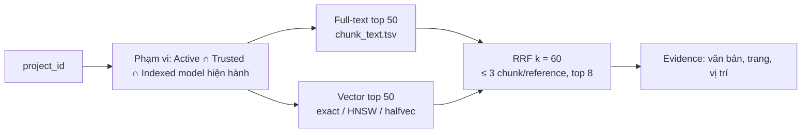

# PID-00027 — Triển khai

- **Ticket:** [PID-00027](../../../docs/tickets/issues/PID-00027/index.html) · **Báo cáo:** [report.md](report.md)
- **Cập nhật:** 19/11/2026 (Lần 2: thêm 4 loại bẫy vào `test_isolation.py`, G5 của QC)

File này mô tả mã **đang thật sự chạy**, đọc từ mã sau khi làm, để người sau hiểu nhanh và QC biết nên soi ở đâu. Không chép lại spec. Sửa mã thì sửa file này cho đúng.

## 1. Luồng đã triển khai

Mã là spike đo (`apps/knowledge/spikes/spk_04/`, không vào wheel của service). Có ba luồng: nạp dữ liệu, đo, kiểm cách ly. Cả ba dùng cùng một bộ sinh dữ liệu tất định và cùng một hàm truy xuất.

**Nạp dữ liệu** (`python -m spikes.spk_04.seed`, slice S01):

1. Tạo database `sires_knowledge_<hex>` bằng `sires_common.testing.fixtures.create_service_database`: ba vai trò `sires_knowledge_app/_system/_purge`, chạy `docs/database/ddl/00-common.sql` rồi `knowledge.sql` nguyên văn (file này tự bật RLS và cấp quyền) — `schema.py:105`.
2. Thêm đối tượng riêng của spike ở schema `spk04`: ba bản sao của cột vector (`spk04.emb_halfvec` EXTERNAL, `spk04.emb_vector_plain`, `spk04.emb_halfvec_plain` lưu `STORAGE PLAIN`), mỗi bảng có RLS và quyền như bảng vector của DDL; bỏ tạm index GIN `chunk_text_tsv_idx` và HNSW `emb_openai_text_embedding_3_small_hnsw_idx` để nạp nhanh — `schema.py:37`, `schema.py:44`, `schema.py:122`.
3. Ghi bản sao `replica.*` (5.000 reference/tài khoản, selection Active/Removed, dòng chéo tài khoản) rồi theo lô 100 tài liệu: `app.source_document`, `app.chunk`, `app.chunk_text` (tsvector do trigger DDL điền), `vec.emb_openai_text_embedding_3_small` bằng `COPY` nhị phân — `seed.py:68`, `seed.py:161`.
4. Chép sang ba bản sao (`fill_copy_sql`), dựng lại GIN và HNSW từ chính câu `CREATE INDEX` trong `knowledge.sql`, dựng HNSW trên biểu thức `embedding::halfvec(1536)`, `VACUUM (ANALYZE)`, `CHECKPOINT` — `seed.py:221`, `schema.py:64`. Database nạp trước khi có bản sao PLAIN: `seed --extend` chỉ thêm bản sao còn thiếu — `seed.py:296`.
5. Ghi manifest (số dòng, kích thước, thời gian, số chunk body của từng project) — `seed.py:240`.

**Đo** (`python -m spikes.spk_04.measure`, slice S02, PID-00027-AC01):

1. Đọc manifest, dựng lại truy vấn từ seed (`Synth.query`; `--first-query` cho lượt cache lạnh) — `measure.py:277`, `synth.py:251`.
2. Mỗi truy vấn chạy mọi phương án theo thứ tự xoay vòng, mỗi lần là một giao dịch `tenant_transaction` của vai trò `sires_knowledge_app` (RLS bật) — `measure.py:172`, `measure.py:195`.
3. `retrieve`: `plan_cache_mode = force_custom_plan` (+ tham số HNSW) → bảng vector theo embedding model của tài khoản → phạm vi → nhánh full-text top 50 → nhánh vector top 50 theo phương án (bảng DDL hoặc bản sao, `retrieval.py:36`) → RRF → evidence — `retrieval.py:215`.
4. Thống kê p50/p95/p99 (numpy, nội suy tuyến tính), recall@50 và độ trùng top 8 so với `exact:vector` cùng truy vấn, số lần nhánh vector trả < 50; EXPLAIN (ANALYZE, BUFFERS) truy vấn 0, rút gọn vector và mảng phạm vi thành kích thước (`compact_plan`) — `measure.py:153`, `measure.py:121`, `measure.py:147`.
5. Ghi JSON (kèm mẫu thời gian từng lần), bảng Markdown, file EXPLAIN vào `agent/execution/PID-00027/spk04/`.

**Kiểm cách ly** (`pytest spikes/spk_04`, slice S02, PID-00027-AC02):

1. `test_isolation`: dựng dữ liệu SMALL trong database mới (Testcontainers, hoặc máy chủ ở `SPK04_ADMIN_DSN`) — `test_isolation.py:290`.
2. Cắm chunk bẫy có đúng vector truy vấn (khoảng cách 0) và lặp lại từ khóa truy vấn — `_plant`, `test_isolation.py:181`; chèn bằng `_insert_chunk` (`test_isolation.py:92`) vào bảng vector của DDL và cả ba bản sao. 10 loại bẫy:
   - tài khoản khác (dòng phạm vi mượn id project);
   - chunk của tài khoản khác mang đúng `reference_id` của một reference trong phạm vi (Lần 2);
   - reference không chọn; selection Removed; reference Revoked;
   - ba reference Trusted, selection Active, nhưng Source Document chưa sẵn sàng: `needs_reindex`, index bằng model khác (thêm tạm `spk04_other_model` vào `app.embedding_model_catalog`), `indexed_at` rỗng — `_unready_reference`, `test_isolation.py:141` (Lần 2);
   - vùng `references`, `appendix` của reference trong phạm vi.

   Thêm một đối chứng dương trong phạm vi.
3. Kiểm đối chứng: bỏ RLS và bộ lọc (owner, quét chính xác) thì bẫy đứng đầu — `test_isolation.py:255`.
4. Chạy `retrieve` cho 10 phương án × 6 truy vấn, so mọi id trả về với tập cho phép tính từ bộ sinh (không từ SQL). Phạm vi trả về phải đúng tập Active ∩ Trusted ∩ Indexed, nên ba reference chưa sẵn sàng không được vào. Đối chứng dương phải đứng đầu nhánh full-text, có trong top 8, và đứng đầu nhánh vector khi quét chính xác — `test_isolation.py:231`, `test_isolation.py:314`.
5. Kiểm lớp thứ hai: câu không có bộ lọc tài khoản vẫn chỉ ra dòng của tài khoản nhờ RLS (bảng DDL, ba bản sao, full-text), không có hai bẫy của tài khoản khác; không đặt `app.account_id` thì 0 dòng — `test_isolation.py:270`.
6. `test_isolation_full_scale` (đặt `SPK04_SCALE_DB`): như trên trên dữ liệu FULL, project 500 reference, trong một giao dịch `SET LOCAL ROLE sires_knowledge_app` (mỗi phương án trong một SAVEPOINT để `SET LOCAL` không lan) rồi rollback — `test_isolation.py:348`.

## 2. Hàm, thuật toán, class ảnh hưởng cao

| Thành phần | Loại | Vị trí | Làm gì | Vì sao ảnh hưởng cao | Giữ bất biến gì | Test |
| --- | --- | --- | --- | --- | --- | --- |
| `SCOPE_SQL` | truy vấn | `retrieval.py:105` | Phạm vi = selection Active ∩ reference Trusted ∩ Source Document đã index bằng model hiện hành, đọc từ bản sao | Sai thì lọt reference ngoài phạm vi (AC02); PID-00093 dùng lại | Phạm vi không nhận từ tham số ngoài `project_id` (INT-VECTOR-001) | `test_isolation.py › test_isolation`, `test_isolation_full_scale` |
| `vector_sql` | hàm | `retrieval.py:141` | Sinh câu vector theo phương án: CTE `MATERIALIZED` cho quét chính xác (bảng DDL hoặc bản sao), `ORDER BY … LIMIT` + sắp lại cho HNSW (cột hoặc biểu thức halfvec); lặp phạm vi trên `app.chunk` (cả `KEYWORD_SQL`, `retrieval.py:122`) | Quyết định kế hoạch thực thi được đo (AC01) | Bộ lọc `account_id`, `reference_id`, `region = 'body'` có ở mọi phương án | `test_isolation.py › test_isolation` |
| `plan_settings` | hàm | `retrieval.py:168` | `SET LOCAL` cho giao dịch: `plan_cache_mode`, `hnsw.ef_search`, `hnsw.iterative_scan`, `hnsw.max_scan_tuples`; `enable_sort = off` chỉ cho câu vector của `hnsw` | Thiếu `force_custom_plan` thì generic plan làm sai số đo (đã gặp, xem report.md mục 3.8) | Tham số không lọt sang giao dịch sau (`SET LOCAL`) | `test_seed.py › test_plan_names`; đo ở `measure-*.json` |
| `fuse` | thuật toán | `retrieval.py:192` | RRF k = 60, khử trùng chunk, ≤ 3 chunk/reference, top 8 | Kết quả cuối của truy xuất lai (kiến trúc 7.4, rc-1) | Thứ tự tất định (hòa điểm xếp theo id) | `test_seed.py › test_fuse_rrf_and_cap` |
| `retrieve` | hàm | `retrieval.py:215` | Một lượt truy xuất lai trong giao dịch tenant, đo thời gian từng bước | Điểm đo của AC01 và đối tượng kiểm của AC02 | Chạy dưới RLS của `sires_knowledge_app` | `test_isolation.py`, `measure.py` |
| `Synth` | class | `synth.py:117` | Sinh tất định id, phạm vi project, vector, văn bản, truy vấn từ `SeedSequence` | Mọi số đo và test phụ thuộc; sinh lại được (S01) | Cùng seed → cùng dữ liệu; dựng không văn bản cho cùng vector | `test_seed.py › test_deterministic`, `test_layout_full_scale`, `test_vector_structure`, `test_queries` |
| `load`, `build_indexes`, `extend` | hàm | `seed.py:161`, `seed.py:221`, `seed.py:296` | Nạp COPY nhị phân, dựng index từ câu DDL | Dữ liệu đúng DDL và đúng quy mô (S01) | Index giống hệt `knowledge.sql` (lấy nguyên câu) | `test_isolation.py` (dùng `seed`), manifest |
| `run_project` | hàm | `measure.py:153` | Khởi động, đo xoay vòng, ground truth, recall, thống kê | Sinh số trong báo cáo | Mọi phương án gặp cùng truy vấn | chạy tay (AC01) |
| `_plant`, `_unready_reference`, `check` | hàm test | `test_isolation.py:181`, `test_isolation.py:141`, `test_isolation.py:231` | Cắm bẫy và đối chứng; so id trả về với tập cho phép | Độ nhạy của test cách ly | Tập cho phép tính độc lập với SQL đang kiểm | `test_isolation` |

### Thuật toán: dữ liệu tổng hợp

- **Vào, ra:** `Scale` (seed 20261119) → id UUIDv7, selection, vector 1.536 chiều (float32, chuẩn hóa), văn bản chunk, truy vấn.
- **Các bước:** vector chunk = √0,20·hướng chung + √0,25·topic + √0,25·tài liệu + √0,30·nhiễu chunk, chuẩn hóa (cosine kỳ vọng ≈ 0,70 cùng tài liệu, ≈ 0,45 cùng topic, ≈ 0,20 không liên quan). Văn bản: 72 % từ Zipf (20.000 từ), 23 % từ của topic (300 từ/topic), 5 % từ riêng của tài liệu (8 từ, như tên riêng). Truy vấn: vector = √0,7·một chunk body trong phạm vi + √0,3·nhiễu; văn bản = 2 từ topic + 1 từ riêng (`specific`, 60 %), thêm 1 từ tần suất trung bình (`broad`, 30 %) hoặc 1 từ top 10 (`stopword`, 10 %), nối bằng `or`.
- **Độ phức tạp, chi phí:** mỗi tài liệu một generator riêng (`[seed, 3, account, reference]`), dựng lại một tài liệu ≈ 1 ms; nạp FULL ≈ 9 phút; bản sao halfvec, GIN, hai HNSW và `VACUUM (ANALYZE)` ≈ 17 phút; hai bản sao PLAIN thêm ≈ 9 phút (manifest).
- **Trường hợp biên đã xử lý:** EC03 — chỉ có một bảng vector 1.536 chiều trong DDL nên `DIM` cố định (xem report.md).

### Thuật toán: truy xuất lai có lọc

- **Vào, ra:** `project_id`, vector truy vấn, văn bản truy vấn → top 50 vector, top 50 full-text, top 8 sau RRF kèm evidence.
- **Các bước:** như mục 1; full-text dùng `websearch_to_tsquery('app.sires_simple', …)` với `or` (nhiều khớp hơn AND, tức trường hợp đắt hơn) và `ts_rank_cd`.
- **Độ phức tạp, chi phí:** quét chính xác đọc mọi vector trong phạm vi (≈ 46.000 chunk body cho 500 reference); HNSW đọc ≈ 50/độ chọn lọc ứng viên, tối đa `hnsw.max_scan_tuples` (20.000). Số đo ở report.md.
- **Trường hợp biên đã xử lý:** phạm vi rỗng hoặc nhỏ (HNSW `iterative_scan = off` trả thiếu — được đo, không dùng); `relaxed_order` có thể lệch thứ tự nên sắp lại 50 dòng ngoài CTE.

## 3. Quyết định kỹ thuật trong phạm vi

- Python chạy trong container Linux (`ghcr.io/astral-sh/uv:0.13.7-python3.12-trixie-slim`) cùng docker network với PostgreSQL — Smart App Control chặn `uv run` trên Windows; spec 2.5 yêu cầu Linux/WSL2.
- Driver `asyncpg` (đã có qua `sires-common`) và helper `sires_common.tenancy.tenant_transaction` — giống đường gọi DB thật của service Python.
- Thêm `numpy` vào nhóm `dev` của `apps/knowledge/pyproject.toml` (cùng `sires-common[testing]` cho Testcontainers); `uv.lock` sinh lại, chỉ thêm `numpy 2.5.5`.
- Phạm vi lấy một lần thành mảng `uuid[]` rồi dùng cho cả hai nhánh (`= ANY($2)`), thay vì CTE phạm vi lặp ở từng nhánh như ví dụ ở database 7.5.
- Quét chính xác viết bằng CTE `MATERIALIZED`; HNSW ép bằng `enable_sort = off` chỉ cho câu vector — để mỗi phương án chạy đúng kế hoạch, kiểm bằng EXPLAIN ở `spk04/*.explain.txt`.
- `halfvec` đo theo hai cách: bảng sao `spk04.emb_halfvec` (quét chính xác) và index HNSW trên biểu thức của bảng DDL (không đổi bảng).
- Thêm hai bản sao `STORAGE PLAIN` sau khi pha A cho thấy quét chính xác tốn phần lớn thời gian ở tra TOAST — để đề xuất cách lưu (P4); thêm pha 4 client và pha cache lạnh để kiểm độ vững của kết luận (P2). Các bản sao chỉ ở schema `spk04` của database đo.
- Lượt cache lạnh điều khiển từ WSL (khởi động lại container, `drop_caches`), mỗi lượt gọi `measure.py --queries 1 --warmup 0 --first-query N`; script điều khiển nằm ngoài repo, cách làm ghi ở README của spike.
- Văn bản truy vấn nối bằng `or` (trường hợp nhiều khớp nhất); cách ghép thật thuộc PID-00093.

---

<!-- SPDX-License-Identifier: LicenseRef-eTroy-NC-1.0 -->
SIRes — Copyright © 2026 The eTroy development team · eTroy One platform. Sole decision-maker: PO Trịnh Quang Trung. Non-commercial use only; commercial use in any form is prohibited. See [LICENSES.md](../../../LICENSES.md).
